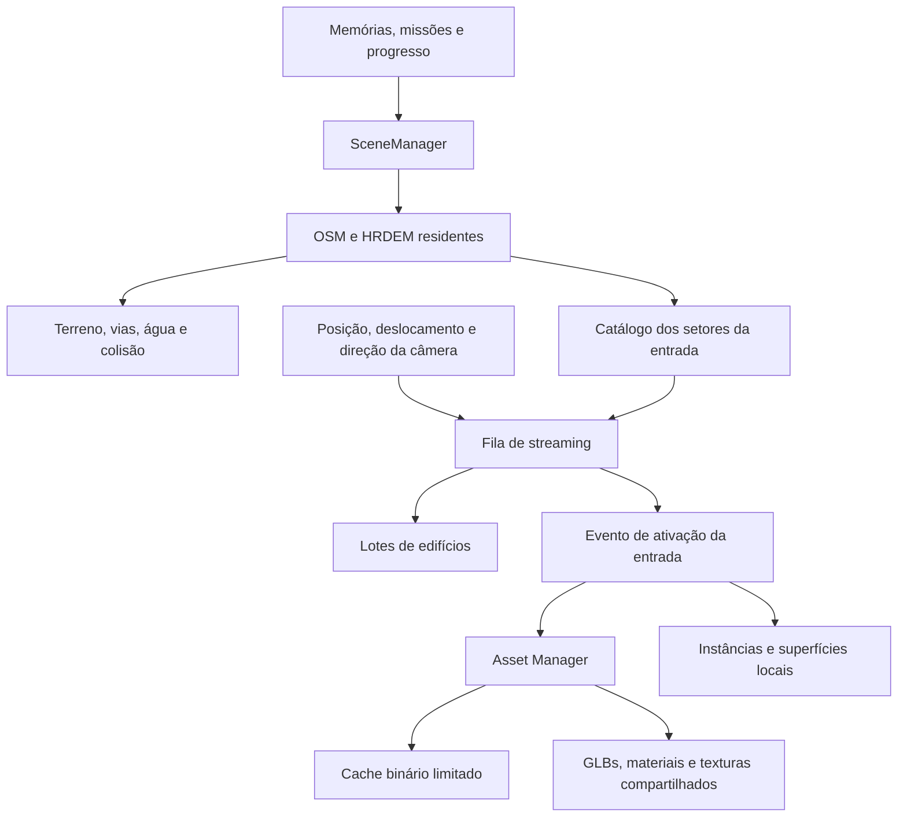

# Streaming geográfico em High Park

## Auditoria e proposta

SceneManager troca regiões inteiras. Na prévia ampliada, a malha HRDEM já é
particionada e a elevação para colisão é consultada diretamente nos dados.
Vias, água, colisões e pontos de memória são globais à região. Edifícios
genéricos já são agrupados espacialmente, mas eram todos construídos antes
da primeira imagem. O acervo da entrada era baixado e decodificado em
paralelo antes de o SceneManager receber o mapa.

O piloto mantém uma base navegável contínua, reaproveita o grid do HRDEM
para construir lotes independentes de edifícios no norte e associa a arte da
entrada a um conjunto de setores com dependências próprias. A origem, o
footprint OSM, a elevação e as colisões continuam no mesmo espaço local.

## Funcionamento do piloto

- Em `?park=expanded`, cada setor de detalhe usa 16 intervalos do grid HRDEM
  (aproximadamente 129 × 128 m). Seu ID permanece vinculado aos índices do
  recorte. A malha de terreno sempre visível usa os chunks de 32 intervalos
  existentes, gerados pela mesma função.
- Edifícios genéricos dentro do piloto recebem um lote por setor. A posição,
  a altitude e a colisão vêm das feições residentes. Edifícios fora do
  piloto, água, caminhos e terrenos continuam seguindo o fluxo anterior.
- O conjunto do arco é uma unidade artística com limites próprios que cruzam
  setores, já que seus pilares, grades, texturas de piso e árvores compõem
  a mesma entrada. A colisão dos pilares está pronta desde a base.
- O planejamento usa distância à borda, previsão de dois segundos de
  movimento e até 26 m na direção da câmera. A margem de saída é maior
  que a margem de entrada, com carência de 1,4 s. Um construtor de lote
  avança por vez. A construção de edifícios usa fatias de cerca de 3 ms
  entre frames. A instalação de um lote ou do conjunto da entrada é atômica
  e tem duração registrada. A fila binária permite até dois downloads ou
  decodificações ativos em conjunto.
- A entrada fica em alta perto da câmera no preset High e usa os LODs
  Balanced mais longe ou no preset Balanced. Ao sair de alcance o setor
  libera os materiais, texturas, malhas instanciadas e mapas de sombra.
  Reentrar reutiliza até 8 MiB de payloads binários em RAM e decodifica os
  assets conforme a demanda. Esse teto é do cache de arquivos, não uma meta
  de memória GPU para telefones.
- Na troca de cena o loading mostra etapas e bytes efetivamente lidos da
  base. Uma falha de arte durante a exploração deixa a base navegável e
  tem nova tentativa após 2,5 s quando o setor continua relevante.
  Falhas de região preservam o portal da cena anterior para a próxima tentativa.
- Memórias, missões e progresso ficam ligados à região e ao estado persistido.
  O lançamento atual tem uma memória. A chegada distante é exercitada pelo
  gancho de revisão, pois o jogo ainda não tem comando de viagem rápida.

## Novos landmarks

1. Fixar a âncora geográfica e o footprint no manifesto de dados. Registrar
   limites locais com a projeção já importada e apontar os setores vizinhos.
2. Separar colisões e interações persistentes do GLB. A base deve continuar
   navegável com o arquivo ausente.
3. Declarar assets, dependências reutilizáveis e LODs. Adquirir cada recurso
   pelo Asset Manager e liberar o lease no descarregamento. Materiais
   configurados por instância devem ser clonados.
4. Separar conjuntos grandes em lotes independentes. Dar preferência a
   preparação incremental e publicar o grupo apenas depois de pronto.
5. Capturar antes e depois nas mesmas poses, testar várias idas e voltas e
   repetir o percurso em Safari iOS e Chrome Android antes de ampliar a cobertura.

Os GLBs mantêm as malhas autorais. O carregador aceita Meshopt em glTF, mas
os modelos atuais não usam a extensão. Draco adicionaria outro decodificador,
e KTX2/BasisU requer transcodificação e validação nas GPUs-alvo. Os JPEGs
continuam com 512 px e as folhas usam atlas com alfa. Esta entrega mede os
arquivos atuais; não mede diferenças de qualidade ou de decodificação entre
codecs. O cache evita transferir a mesma arte ao recarregar setores durante
a sessão sem manter todas as texturas descomprimidas na GPU.

## Evidência automatizada

`npm run review:export` inclui `world-streaming.json` e uma caminhada
em WebM. Um controle eager usa o mesmo código e prepara todos os setores
antes da primeira cena. A comparação histórica por ZIP é independente.
O percurso acelerado passa por três setores de detalhe, testa ida e retorno,
e registra frames acima de 50 ms, estado dos setores, memória estimada,
tempos de ativação e downloads. Mobile é Chromium emulado.
